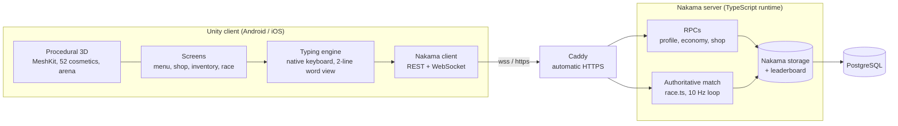
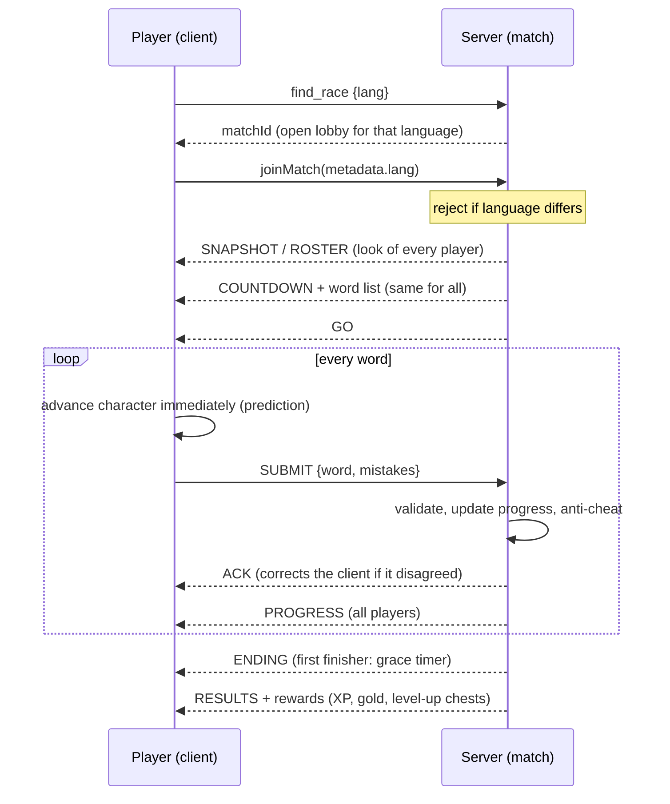

<div align="center">


# TextRun

**A real-time, 5-player online typing race for Android and iOS.**
You run a 3D character down a track by typing words: the faster and cleaner you type, the faster you run.

Unity client · authoritative **Nakama** server in **TypeScript** · PostgreSQL · Docker · HTTPS

[**Download the Android APK**](https://github.com/furkan-eroglu/textrun/releases/latest) · [Türkçe README](README.tr.md) · [Wire protocol](docs/PROTOCOL.md) · [Design decisions](docs/KARARLAR.md) · [Credits](docs/CREDITS.md)

</div>

> **Status:** solo project in closed testing on Android (live server running, not yet on Google Play). Source is published as a portfolio piece, all rights reserved.

---

## The game


- **5-player races.** Random matchmaking per language (Turkish and English players are never mixed), or **private rooms** with a 5-letter code where the host starts the race, with or without bots.
- **Word-based typing.** Unrelated words on two lines, played with the phone's native keyboard, with full Turkish character support. Correct words move your runner instantly; the server confirms.
- **Progression.** XP and levels, **one chest for every level-up** (bronze, silver, gold by level), gold from races.
- **Collection.** 52 cosmetics in 5 categories (head, top, bottom, shoes, cape) across five rarity tiers, plus skin tones and a body type. Cosmetics never affect gameplay.
- **Meta.** A daily shop (4 rotating items, gold chest, diamond chest, diamond refresh), a daily rewarded-ad chest, a top-10 leaderboard by level, and a results **podium** that shows the top three players' real characters in whatever they are wearing.
- **Polish.** Chest-opening sequence with rarity-based effects, running capes, a crowd of hundreds in a procedural arena, synthesised sound, Turkish and English UI switchable in game.


---

## The Unity client

The client is a thin, fast renderer: it shows the state the server sends and predicts only what can be corrected.

| Area | How it works |
|---|---|
| **Typing engine** | `TypingSession`, `WordInput` and the keyboard tracker are plain C# with no Unity dependency, covered by **151 self-tests** that run in batch mode. Keystrokes from the native OS keyboard are reduced to an accepted/rejected character stream; wrong keys are ignored, a word is submitted on space, and the two-line word view advances as lines complete. |
| **Prediction and reconciliation** | When you finish a word your runner moves immediately and the word is sent to the server. The server's `ACK` carries its own word index; if it disagrees, the client rolls back to the server's value. Opponents are driven purely by server `PROGRESS` messages and smoothed. |
| **Resilient sessions** | A saved race identity lets the client rejoin a running race after a dropped connection, a killed app or a backgrounded phone, and drop quietly back to the menu if the race is already over. |
| **Screen architecture** | One state machine (`Page` enum) split into focused partial classes: menu, inventory, shop, leaderboard, results. A small UI kit (`UiKit`) draws the rounded cards and chunky buttons, scaled by DPI. All strings go through a central table (`Loc`) so a language is one new column. |
| **Network layer** | `OnlineRaceClient` wraps the Nakama .NET client: authentication, socket events, RPCs, resume logic. The wire format is a small set of DTOs ([`Protocol.cs`](client/Assets/Scripts/Online/Protocol.cs)) mirrored from the server. |
| **Performance** | The arena is merged by colour into a handful of draw calls (`MeshBatch`), the crowd bobs in four shared groups, previews render to small textures only while visible. The release APK is about 20 MB. These choices are aimed at keeping the frame rate smooth on mid-range phones. |
| **Self-verification** | A `-devharness` build plays through every screen and saves screenshots on its own, which is how the UI was checked on desktop and how the images in this README were made. An online integration test drives the real client against a real server. |

### Everything you see is generated in code

There are no imported models, textures or audio samples (apart from two credited sound files). The character and all 52 cosmetics are built at runtime by a small mesh toolkit, [`MeshKit.cs`](client/Assets/Scripts/Characters/MeshKit.cs):

- **Surfaces of revolution** from a radius/height profile, for the torso, limbs, hats, boots and sleeves. Clothes are bands that follow the body's own profile, so a shirt fits the male and female body shapes without separate art.
- **Rounded boxes**, **extruded outlines** (stars, wing feathers, crown spikes, visors) and **cloth sheets** (capes with folds that swing back while you run).
- One registry maps an item id to a builder function ([`Outfits.cs`](client/Assets/Scripts/Characters/Outfits.cs)); the same ids exist on the server. Adding an item is one line in each place.
- Shop and inventory thumbnails are **rendered at runtime** by putting the item on a mannequin and photographing it with an orthographic camera into a `RenderTexture`. The live character preview and the results podium use the same trick.


The arena (concrete tiers, seats, aisles with tunnel mouths, sponsor boards in a pixel font made of cubes, glass boxes, roof trusses with floodlights, a giant screen) and the sounds ([`SoundSynth.cs`](client/Assets/Scripts/Audio/SoundSynth.cs): chest rattle, riser and bell sequences) are procedural as well.


*Screenshots are from a desktop build with sample data.*

---

## The server (Nakama, TypeScript)

Everything that has value is decided in [`server/`](server); the client is treated as untrusted.

| Area | What it does |
|---|---|
| **Authoritative races** | The server owns the word list, the clock, progress and the final ranking. Each submission is validated in order; early or out-of-turn ones are ignored. |
| **Anti-cheat** | Sustained WPM above a configurable ceiling disqualifies the player (0 XP, 0 gold). Private rooms pay no rewards, so two phones can't farm XP against each other. |
| **Language-isolated matchmaking** | Turkish and English are **never** mixed, enforced in `matchJoinAttempt` (the client's language is verified against the room) for public lobbies and private rooms. Turkish normalisation handles `İ/ı`, `ç ğ ö ş ü`. |
| **Match handler** | One authoritative Nakama match per race, 10 Hz loop: lobby, countdown, racing, results. Bots fill empty seats and are labelled as bots. A grace window after the first finisher lets others catch up. |
| **Reconnection** | A player can rejoin a running race with the same identity. A per-connection `sessionId` guard makes a late "left" event from a dead socket harmless. |
| **Persistent economy** | XP, levels, gold, diamonds, chests, inventory, equipped items and shop state live in Nakama storage, written only by the server with **optimistic concurrency** (version check and retry). |
| **Server-side randomness** | Chest rolls (rarity weights per tier, duplicates converted to gold), a per-player daily shop rotating at 00:00 Turkey time, a once-per-day ad chest. All odds and prices are configuration. |
| **Leaderboard** | Nakama leaderboard with rank cache: top 10 by level plus the caller's own rank. |
| **API** | 15 RPCs (`find_race`, `create_room`, `join_room`, `open_chest`, `equip_item`, `shop_buy`, `claim_ad_chest`, `get_leaderboard`, ...) plus the realtime op-codes in [`docs/PROTOCOL.md`](docs/PROTOCOL.md). |
| **Tests** | **52 unit tests** for the pure game rules run on plain Node. **11 end-to-end scenarios** drive real WebSocket clients against a real Nakama: 10 players in two languages at once, 12 concurrent matchmakers, reconnects, private rooms, anti-cheat, guest rules, shop and chests. |
| **Ops** | [`server/deploy`](server/deploy): Docker Compose (Nakama, Postgres, Caddy), automatic HTTPS, generated secrets kept out of git, firewall, nightly `pg_dump` with 7-day retention. |

### Architecture



### One race, end to end



---

## Play it

An Android build is attached to the [latest release](https://github.com/furkan-eroglu/textrun/releases/latest). Install it (allow "install unknown apps"), create an account and race. It connects to the project's test server; new accounts start with test gold and diamonds so every feature can be tried. It is not signed for Google Play.

## Repository layout

```
client/            Unity 6 project (Android / iOS)
  Assets/Scripts/  Game, Race, Typing, Characters, Audio, Online (Nakama client)
server/            Nakama TypeScript module
  src/             race.ts, match.ts, profile.ts, economy.ts, leaderboard.ts, ...  (+ unit tests)
  test/e2e.mjs     end-to-end scenarios against a live Nakama
  deploy/          production Docker Compose, Caddy, setup script, backup
content/words/     Turkish and English word lists (+ tools/words to rebuild them)
docs/              protocol, design decisions, credits, images
```

## Running it

**Server** (Node 22+, Docker):

```bash
cd server
npm install
npm run build              # bundles src/ into build/index.js
docker compose up -d       # Nakama + PostgreSQL on localhost:7350
npm test                   # 52 unit tests, no Docker needed
```

End-to-end tests need the server started with fast timings:

```bash
TEXTRUN_LOBBY_WAIT_MS=3000 TEXTRUN_WORD_COUNT=8 TEXTRUN_MAX_WPM=100000 \
TEXTRUN_FINISH_GRACE_MS=3000 TEXTRUN_COUNTDOWN_MS=1500 docker compose up -d --force-recreate nakama
node test/e2e.mjs
```

**Client:** open `client/` with Unity **6000.5.4f1**, run the menu command *TextRun → Create Online Game Scene*, press Play. The desktop build talks to the local server above; mobile builds use the settings in `ServerSettings.cs`.

## Notes

- The UI is currently IMGUI, a deliberate shortcut while the game design settled. A move to uGUI is planned.
- Rewarded ads and real-money diamond purchases are not wired up yet (the server side of the daily chest is in place; the ad SDK is not).
- Third-party audio is credited in [`docs/CREDITS.md`](docs/CREDITS.md). One short UI sound is not included in this repository, and the game falls back to a synthesised sound without it.
- The Nakama *server key* embedded in the client is not a secret by design (it ships in every build). The real secrets (database password, session and console keys) are generated on the server and are not in this repository.

---

Built by **Furkan Eroğlu** · Turkey · [GitHub](https://github.com/furkan-eroglu)
