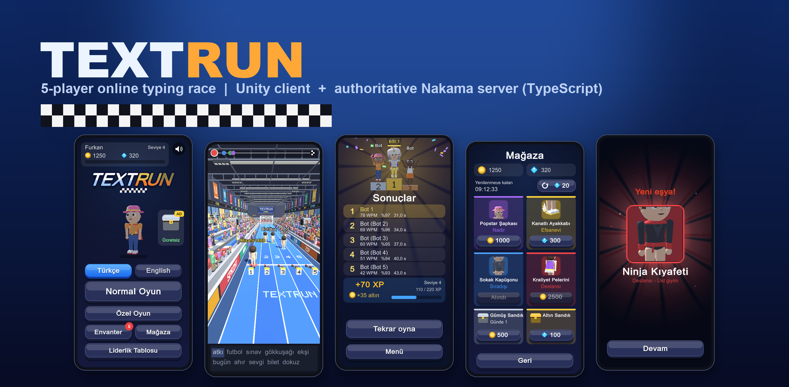
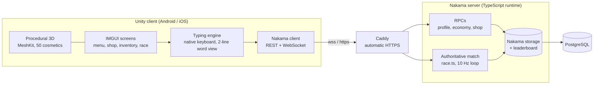
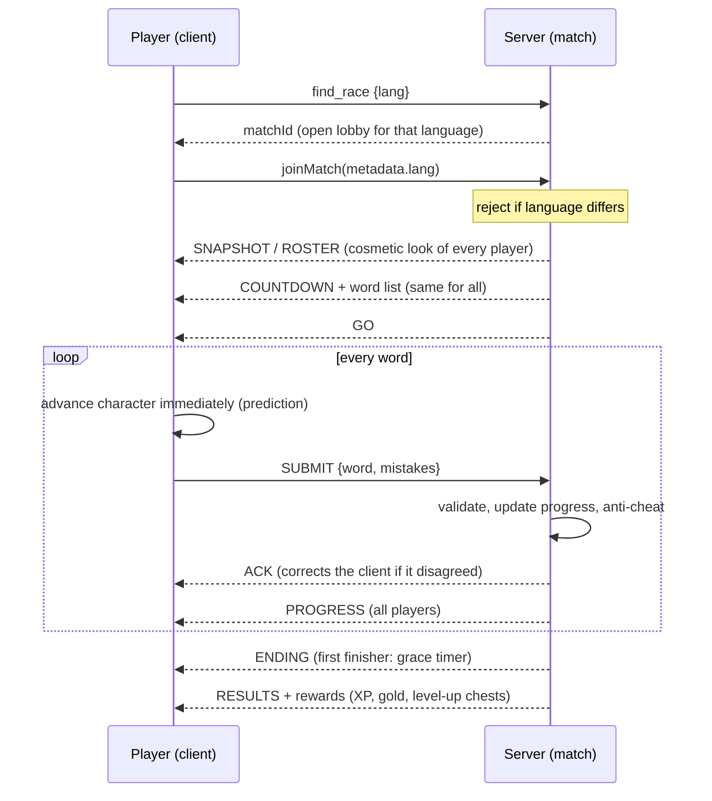
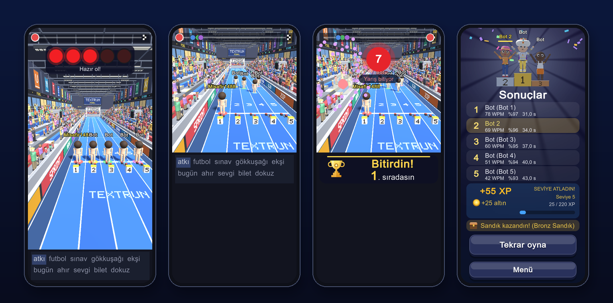
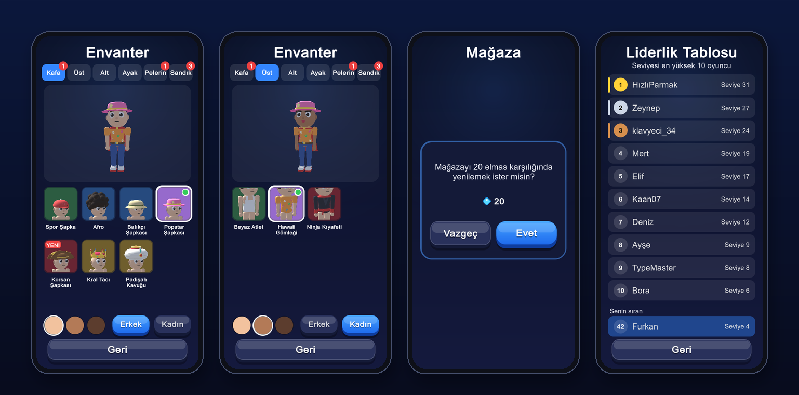
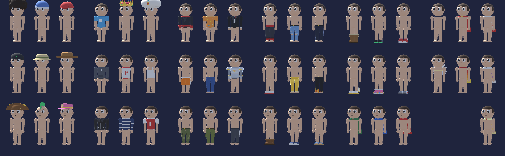
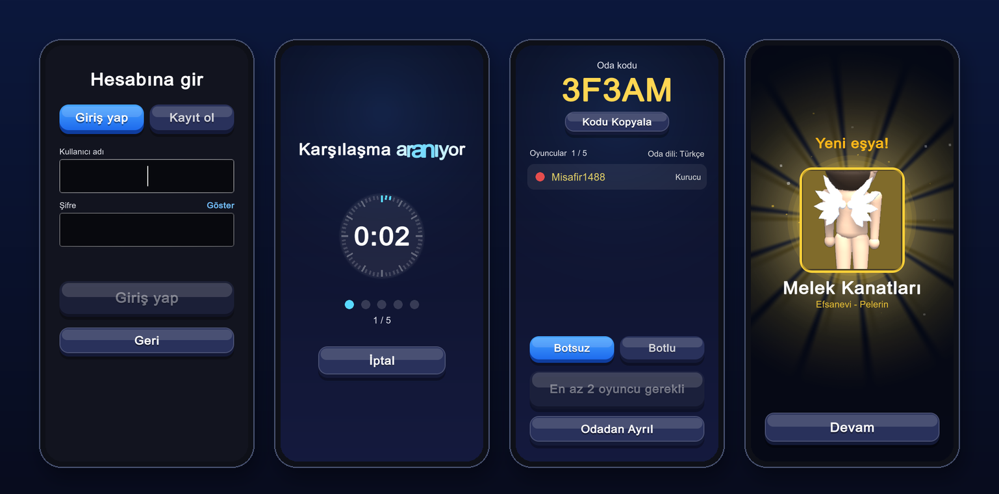

<div align="center">



# TextRun

**A real-time, 5-player online typing race for Android and iOS.**
Players run 3D characters down a track by typing words; the faster and cleaner they type, the faster they run.

Unity client · authoritative **Nakama** game server written in **TypeScript** · PostgreSQL · Docker · HTTPS

[Türkçe README](README.tr.md) · [Wire protocol](docs/PROTOCOL.md) · [Design decisions](docs/KARARLAR.md) · [Credits](docs/CREDITS.md)

</div>

> **Status:** solo project, in closed testing on Android (live server running, not yet on Google Play). Source is published as a portfolio piece, all rights reserved.

---

## Why this repo might interest you (backend view)

The interesting part is the server in [`server/`](server): everything that has value is decided there and the client is treated as untrusted.

| Area | What it does |
|---|---|
| **Authoritative races** | The server owns the word list, the clock, progress and the final ranking. Clients only send "I finished this word"; the server validates each submission in order, ignores early or out-of-turn ones, and answers with an ACK that can correct the client's local prediction. |
| **Anti-cheat** | Sustained WPM above a configurable ceiling disqualifies the player (0 XP, 0 gold). Submissions are checked against the server's own word list. Private rooms pay no rewards, so two phones can't farm XP against each other. |
| **Language-isolated matchmaking** | Turkish and English players are **never** placed in the same race. Enforced server-side in `matchJoinAttempt` (client-supplied language is verified against the room), for public lobbies and private rooms alike. Turkish text normalisation handles `İ/ı`, `ç ğ ö ş ü`. |
| **Match handler design** | One authoritative Nakama match per race with a 10 Hz loop: lobby → countdown → racing → results. Bots fill empty seats (clearly flagged as bots). A race can wait for stragglers with a configurable grace window after the first finisher. |
| **Reconnection** | A player who loses connection (or kills the app) can rejoin a running race with the same identity. A per-connection `sessionId` guard makes a late "left" event from a dead socket harmless. |
| **Persistent economy** | XP, levels, gold, diamonds, chests, inventory, equipped items and daily shop state live in Nakama storage, written only by the server with **optimistic concurrency** (version check and retry), so parallel writes can't lose updates. |
| **Server-side randomness** | Chest rolls (rarity weights per chest tier, duplicate-to-gold conversion), a per-player daily shop that rotates at 00:00 Turkey time, rewarded-ad chest with a once-per-day lock. All odds and prices are configuration, not code. |
| **Leaderboard** | Nakama leaderboard with rank cache; top 10 by level plus the caller's own rank. |
| **API surface** | 15 RPCs (`find_race`, `create_room`, `join_room`, `open_chest`, `equip_item`, `shop_buy`, `shop_refresh`, `claim_ad_chest`, `get_leaderboard`, ...) plus the realtime op-codes documented in [`docs/PROTOCOL.md`](docs/PROTOCOL.md). |
| **Tests** | 52 unit tests for the pure game rules (race engine, profile/economy, shop) run on plain Node; **11 end-to-end scenarios** drive real WebSocket clients against a real Nakama (10 players in two languages at once, 12 concurrent matchmakers, reconnects, private rooms, anti-cheat, guest rules, shop, chests). |
| **Ops** | Production stack in [`server/deploy`](server/deploy): Docker Compose (Nakama + Postgres + Caddy), automatic HTTPS, generated secrets kept out of git, firewall, nightly `pg_dump` with 7-day retention. |

### Architecture



### One race, end to end



---

## The game



- **5-player races**, random matchmaking per language, or **private rooms** with a 5-letter code (the host decides when to start, with or without bots).
- **Word-based typing**: unrelated words on two lines, native phone keyboard, Turkish characters supported.
- **Progression**: XP and levels, **one chest per level-up** (bronze / silver / gold by level), gold from races.
- **Cosmetics**: 52 items in 5 categories (head, top, bottom, shoes, cape) with five rarity tiers, skin tones and a body type. Cosmetics never affect gameplay.
- **Daily shop** (4 rotating items, gold chest, diamond chest, diamond refresh), a **daily rewarded-ad chest**, a **leaderboard**, a results **podium** that shows the top 3 players' actual characters.
- Turkish and English UI, switchable in game.



### Everything visual is generated in code

There are no imported models or textures. The character and all 52 cosmetics are built at runtime from a small mesh toolkit ([`MeshKit.cs`](client/Assets/Scripts/Characters/MeshKit.cs): surfaces of revolution, rounded boxes, extruded outlines, cloth sheets). Item thumbnails and the live character preview are rendered to textures from the same data, so adding an item is one line of code on the client and one line on the server. Sound effects are synthesised too ([`SoundSynth.cs`](client/Assets/Scripts/Audio/SoundSynth.cs)).



The arena (stands, seats, aisles, sponsor boards, roof trusses, crowd of hundreds of spectators) is also procedural and is batched by colour, so the whole venue is a handful of draw calls on a phone.



*Screenshots are from a desktop build with sample data.*

---

## Repository layout

```
server/            Nakama TypeScript module (the backend)
  src/             race.ts, match.ts, profile.ts, economy.ts, leaderboard.ts, ...  (+ unit tests)
  test/e2e.mjs     end-to-end scenarios against a live Nakama
  deploy/          production Docker Compose, Caddy, setup script, backup
client/            Unity 6 project (Android / iOS)
  Assets/Scripts/  Game, Race, Typing, Characters, Audio, Online (Nakama client)
content/words/     Turkish and English word lists (+ tools/words to rebuild them)
docs/              protocol, design decisions, credits, images
```

## Running it

**Server** (Node 22+, Docker):

```bash
cd server
npm install
npm run build              # bundles src/ into build/index.js
docker compose up -d       # Nakama + PostgreSQL on localhost:7350
npm test                   # 52 unit tests, no Docker needed
```

End-to-end tests need the server started with fast timings:

```bash
TEXTRUN_LOBBY_WAIT_MS=3000 TEXTRUN_WORD_COUNT=8 TEXTRUN_MAX_WPM=100000 \
TEXTRUN_FINISH_GRACE_MS=3000 TEXTRUN_COUNTDOWN_MS=1500 docker compose up -d --force-recreate nakama
node test/e2e.mjs
```

**Client**: open `client/` with Unity **6000.5.4f1**, run the menu command *TextRun → Create Online Game Scene*, press Play. The desktop build talks to the local server above; mobile builds use the settings in `ServerSettings.cs`.

## Notes

- UI is currently IMGUI, a deliberate shortcut while the game design settled. A move to uGUI is planned.
- Rewarded ads and real-money diamond purchases are not wired up yet (the server side of the daily chest is in place; the ad SDK is not).
- Third-party audio is credited in [`docs/CREDITS.md`](docs/CREDITS.md). One short UI sound is not included in this repository, the game falls back to a synthesised sound without it.
- The Nakama *server key* embedded in the client is not a secret by design (it ships in every build). The real secrets (database password, session and console keys) are generated on the server and are not in this repository.

---

Built by **Furkan Eroğlu** · Turkey · [GitHub](https://github.com/furkan-eroglu)
