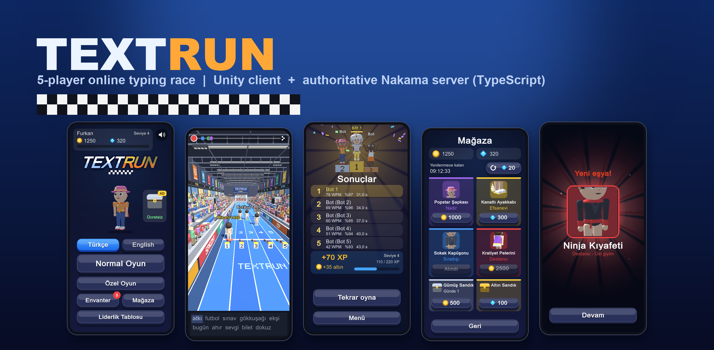
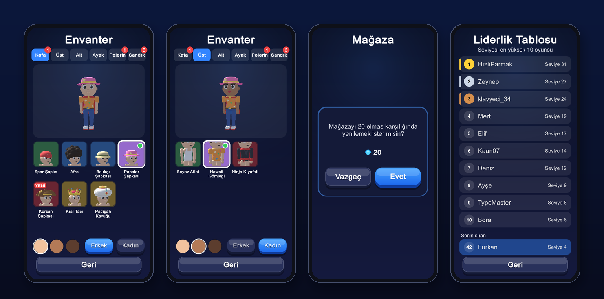
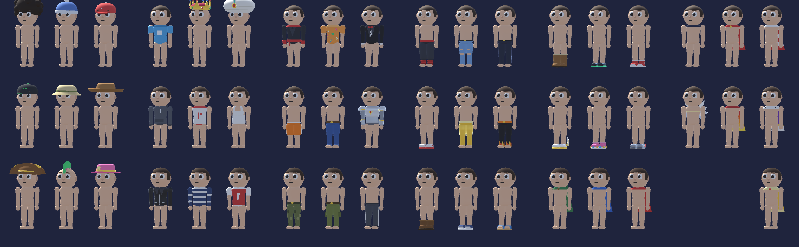
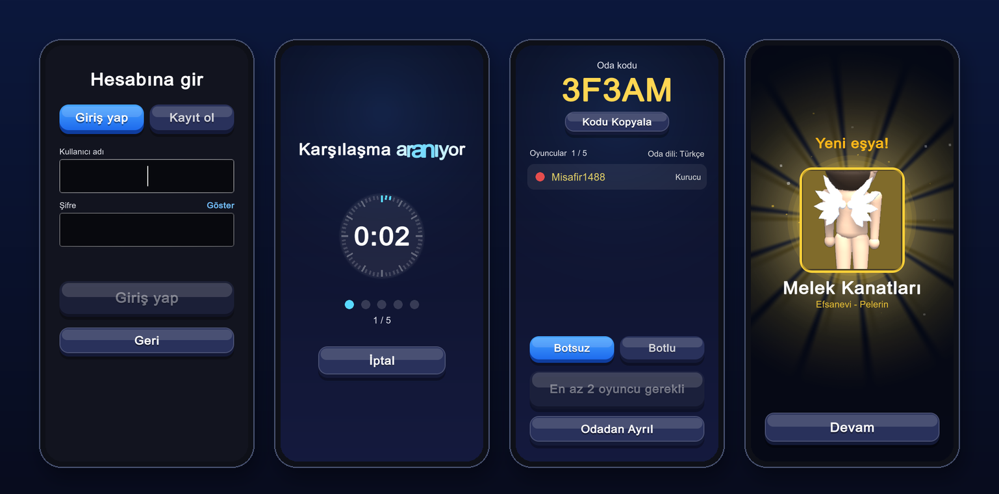

<div align="center">



# TextRun

**Android ve iOS için gerçek zamanlı, 5 kişilik çevrimiçi yazı yarışı.**
Oyuncular kelime yazarak 3B karakterlerini koşturur; ne kadar hızlı ve doğru yazarsan o kadar hızlı koşarsın.

Unity istemcisi · **TypeScript** ile yazılmış, sunucu hakemli **Nakama** oyun sunucusu · PostgreSQL · Docker · HTTPS

[English README](README.md) · [Yarış protokolü](docs/PROTOCOL.md) · [Teknik kararlar](docs/KARARLAR.md) · [Krediler](docs/CREDITS.md)

</div>

> **Durum:** tek kişilik proje, Android'de kapalı testte (canlı sunucu çalışıyor, henüz Google Play'de değil). Kaynak kod portföy amacıyla yayınlanmıştır, tüm hakları saklıdır.

---

## Backend açısından neden ilginç?

Asıl iş [`server/`](server) klasöründeki sunucuda: değeri olan her şey orada karara bağlanır, istemciye güvenilmez.

| Alan | Ne yapıyor |
|---|---|
| **Sunucu hakemli yarış** | Kelime listesini, saati, ilerlemeyi ve sıralamayı sunucu belirler. İstemci yalnızca "bu kelimeyi bitirdim" der; sunucu her gönderimi sırayla doğrular, erken ya da sırasız olanları yok sayar, istemcinin yerel tahminini gerekirse düzelten bir ACK döner. |
| **Hile koruması** | Ayarlanabilir sınırın üstündeki sürekli WPM diskalifiye eder (0 XP, 0 altın). Özel odalar ödül vermez, iki telefonla birbirini yenerek XP kasılamaz. |
| **Dile göre ayrı eşleşme** | Türkçe ve İngilizce oyuncular **asla** aynı yarışa girmez. Bu kural `matchJoinAttempt` içinde sunucuda zorunlu tutulur (istemcinin dediği dil odayla karşılaştırılır), hem herkese açık lobilerde hem özel odalarda. Türkçe metin işleme `İ/ı`, `ç ğ ö ş ü` karakterlerini doğru ele alır. |
| **Maç yönetimi** | Her yarış için 10 Hz döngülü tek bir sunucu hakemli Nakama maçı: lobi → geri sayım → yarış → sonuçlar. Boş koltukları botlar doldurur (bot olduğu belli edilir). İlk bitirenden sonra ayarlanabilir bir bekleme süresi tanınır. |
| **Yeniden bağlanma** | Bağlantısı kopan (ya da uygulamayı kapatan) oyuncu aynı kimlikle süren yarışa geri döner. Bağlantı başına `sessionId` koruması, ölü bir soketin geç gelen "ayrıldı" bildirimini zararsız yapar. |
| **Kalıcı ekonomi** | XP, seviye, altın, elmas, sandıklar, envanter, giyili eşyalar ve günlük mağaza durumu Nakama depolamasında tutulur; yalnızca sunucu yazar ve **iyimser eşzamanlılık** (sürüm kontrolü + yeniden deneme) kullanır, paralel yazmalar güncelleme kaybettirmez. |
| **Sunucuda rastgelelik** | Sandık açma (sandık türüne göre nadirlik ağırlıkları, tekrar eşyayı altına çevirme), her oyuncuya özel ve Türkiye saatiyle 00.00'da yenilenen günlük mağaza, günde bir kez açılan ödüllü reklam sandığı. Bütün olasılıklar ve fiyatlar koda gömülü değil, ayar. |
| **Liderlik tablosu** | Sıra önbellekli Nakama tablosu; seviyeye göre ilk 10 ve çağıranın kendi sırası. |
| **API** | 15 RPC (`find_race`, `create_room`, `join_room`, `open_chest`, `equip_item`, `shop_buy`, `shop_refresh`, `claim_ad_chest`, `get_leaderboard`, ...) ve [`docs/PROTOCOL.md`](docs/PROTOCOL.md) içindeki gerçek zamanlı mesajlar. |
| **Testler** | Saf oyun kuralları için 52 birim testi (yarış motoru, profil/ekonomi, mağaza) düz Node'da çalışır; **11 uçtan uca senaryo** gerçek bir Nakama'ya WebSocket ile bağlanan sahte oyuncularla koşar (iki dilde 10 oyuncu aynı anda, 12 eşzamanlı eşleşme, yeniden bağlanma, özel oda, hile, misafir kuralları, mağaza, sandık). |
| **İşletim** | [`server/deploy`](server/deploy): Docker Compose (Nakama + Postgres + Caddy), otomatik HTTPS, depoda tutulmayan üretilmiş gizli anahtarlar, güvenlik duvarı, 7 gün saklanan gece yedeği. |

Mimari ve bir yarışın akış şeması [İngilizce README](README.md#architecture) içinde.

---

## Oyun


- **5 kişilik yarışlar**, dile göre rastgele eşleşme ya da 5 harfli kodla **özel odalar** (kurucu başlatır, botlu ya da botsuz).
- **Kelime tabanlı yazma**: iki satırda birbirinden bağımsız kelimeler, telefonun kendi klavyesi, Türkçe karakter desteği.
- **İlerleme**: XP ve seviye, **her seviye atlamada bir sandık** (seviyeye göre bronz / gümüş / altın), yarıştan altın.
- **Kozmetik**: 5 kategoride (kafa, üst, alt, ayakkabı, pelerin) 52 eşya, beş nadirlik, ten rengi ve beden tipi. Kozmetik oyuna hiçbir avantaj vermez.
- **Günlük mağaza**, **günlük ödüllü reklam sandığı**, **liderlik tablosu** ve sonuçta ilk 3 oyuncunun gerçek karakterlerini gösteren **kürsü**.
- Oyun içinden değiştirilebilen Türkçe ve İngilizce arayüz.



### Görselliğin tamamı kodla üretiliyor

İçeri aktarılmış model ya da doku yok. Karakter ve 52 eşyanın hepsi çalışma anında küçük bir ağ araç takımıyla ([`MeshKit.cs`](client/Assets/Scripts/Characters/MeshKit.cs)) kuruluyor. Eşya resimleri ve canlı karakter önizlemesi aynı veriden dokuya çiziliyor; yeni eşya eklemek istemcide bir, sunucuda bir satır. Sesler de kodla üretiliyor ([`SoundSynth.cs`](client/Assets/Scripts/Audio/SoundSynth.cs)).



Arena (tribünler, koltuklar, merdivenler, sponsor panoları, çatı kirişleri, yüzlerce seyirci) de kodla kuruluyor ve renge göre birleştiriliyor; telefonda salonun tamamı birkaç çizim çağrısı tutuyor.



*Görüntüler bilgisayardaki bir derlemeden, örnek verilerle alınmıştır.*

---

## Depo yapısı

```
server/            Nakama TypeScript modülü (backend)
  src/             race.ts, match.ts, profile.ts, economy.ts, leaderboard.ts, ...  (+ birim testleri)
  test/e2e.mjs     canlı Nakama'ya karşı uçtan uca senaryolar
  deploy/          canlı Docker Compose, Caddy, kurulum betiği, yedek
client/            Unity 6 projesi (Android / iOS)
content/words/     Türkçe ve İngilizce kelime listeleri
docs/              protokol, kararlar, krediler, görseller
```

## Çalıştırma

Komutlar [İngilizce README](README.md#running-it) içinde aynı: sunucu için `npm run build`, `docker compose up -d`, `npm test`; istemci için Unity **6000.5.4f1** ile `client/` klasörünü açıp *TextRun → Create Online Game Scene* menüsünü çalıştırmak.

## Notlar

- Arayüz şu an IMGUI, oyun tasarımı oturana kadar bilinçli bir kısayol. uGUI'ye geçiş planlı.
- Ödüllü reklam ve gerçek parayla elmas satışı henüz bağlı değil (günlük sandığın sunucu tarafı hazır, reklam SDK'sı değil).
- Üçüncü taraf sesler [`docs/CREDITS.md`](docs/CREDITS.md) içinde anılıyor. Kısa bir arayüz sesi bu depoda yer almıyor; yokluğunda oyun kodla üretilen sesi çalıyor.
- İstemciye gömülü Nakama *sunucu anahtarı* tasarımı gereği gizli değildir (her derlemeyle dağıtılır). Gerçek gizli değerler (veritabanı şifresi, oturum ve yönetim anahtarları) sunucuda üretilir ve bu depoda yoktur.

---

**Furkan Eroğlu** tarafından geliştirildi · Türkiye · [GitHub](https://github.com/furkan-eroglu)
