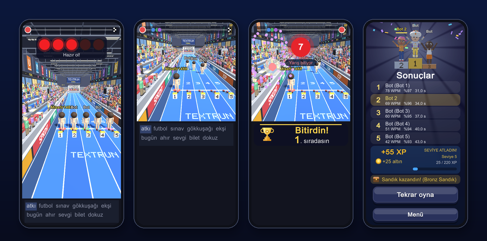

<div align="center">


# TextRun

**Android ve iOS için gerçek zamanlı, 5 kişilik çevrimiçi yazı yarışı.**
Kelime yazarak 3B karakterini pistte koşturursun: ne kadar hızlı ve temiz yazarsan o kadar hızlı koşarsın.

Unity istemcisi · **TypeScript** ile yazılmış, sunucu hakemli **Nakama** sunucusu · PostgreSQL · Docker · HTTPS

[**Android APK'yı indir**](https://github.com/furkan-eroglu/textrun/releases/latest) · [English README](README.md) · [Yarış protokolü](docs/PROTOCOL.md) · [Teknik kararlar](docs/KARARLAR.md) · [Krediler](docs/CREDITS.md)

</div>

> **Durum:** tek kişilik proje, Android'de kapalı testte (canlı sunucu çalışıyor, henüz Google Play'de değil). Kaynak kod portföy amacıyla yayınlanmıştır, tüm hakları saklıdır.

---

## Oyun



- **5 kişilik yarışlar.** Dile göre rastgele eşleşme (Türkçe ve İngilizce oyuncular asla karışmaz) ya da 5 harfli kodla **özel odalar**; kurucu yarışı botlu ya da botsuz başlatır.
- **Kelime tabanlı yazma.** İki satırda birbirinden bağımsız kelimeler, telefonun kendi klavyesi, tam Türkçe karakter desteği. Doğru kelime karakterini anında ilerletir, sunucu onaylar.
- **İlerleme.** XP ve seviye, **her seviye atlamada bir sandık** (seviyeye göre bronz, gümüş, altın), yarıştan altın.
- **Koleksiyon.** 5 kategoride (kafa, üst, alt, ayakkabı, pelerin) beş nadirlikte 52 kozmetik eşya, ayrıca ten rengi ve beden tipi. Kozmetik oyuna hiçbir avantaj vermez.
- **Meta.** Günlük mağaza (4 dönen eşya, altın sandık, elmas sandık, elmasla yenileme), günlük ödüllü reklam sandığı, seviyeye göre ilk 10 liderlik tablosu ve ilk üç oyuncunun gerçek karakterlerini giydikleriyle gösteren sonuç **kürsüsü**.
- **Cila.** Nadirliğe göre efektli sandık açılışı, koşarken uçuşan pelerinler, prosedürel arenada yüzlerce seyirci, kodla üretilen sesler, oyun içinden değişen Türkçe ve İngilizce arayüz.


---

## Unity istemcisi

İstemci ince ve hızlı bir çizici: sunucunun gönderdiği durumu gösterir, yalnızca düzeltilebilecek şeyleri tahmin eder.

| Alan | Nasıl çalışıyor |
|---|---|
| **Yazma motoru** | `TypingSession`, `WordInput` ve klavye izleyicisi Unity'ye bağımlı olmayan düz C#, batch modda çalışan **151 kendi testiyle** kapsanıyor. Telefonun yerel klavyesinden gelen tuşlar kabul/ret edilmiş bir harf akışına indirgeniyor; yanlış tuş yok sayılıyor, boşlukla kelime gönderiliyor, iki satırlı kelime görünümü satır bitince ilerliyor. |
| **Tahmin ve düzeltme** | Kelimeyi bitirince karakterin hemen ilerliyor ve kelime sunucuya gidiyor. Sunucunun `ACK` mesajı kendi kelime sırasını taşıyor; uyuşmazsa istemci sunucunun değerine geri dönüyor. Rakipler yalnızca sunucudan gelen `PROGRESS` mesajlarıyla, yumuşatılarak hareket ediyor. |
| **Dayanıklı oturum** | Saklanan yarış kimliği sayesinde bağlantı kopması, uygulamanın kapanması ya da arka plana alınması sonrası süren yarışa geri dönülüyor; yarış bittiyse sessizce menüye düşülüyor. |
| **Ekran mimarisi** | Tek durum makinesi (`Page`), odaklı kısmi sınıflara bölünmüş: menü, envanter, mağaza, liderlik, sonuçlar. Küçük bir arayüz kiti (`UiKit`) yuvarlak kartları ve kalın düğmeleri DPI'ya göre ölçeklenmiş çiziyor. Tüm metinler merkezi bir tablodan (`Loc`) geliyor, yeni dil tek sütun. |
| **Ağ katmanı** | `OnlineRaceClient` Nakama .NET istemcisini sarıyor: kimlik doğrulama, soket olayları, RPC'ler, geri dönüş mantığı. Mesaj biçimi sunucudakinin aynası küçük bir DTO kümesi ([`Protocol.cs`](client/Assets/Scripts/Online/Protocol.cs)). |
| **Başarım** | Arena renge göre birleştirilip birkaç çizim çağrısına indirilmiş (`MeshBatch`), seyirciler dört ortak grup halinde zıplıyor, önizlemeler yalnızca görünürken küçük dokulara çiziliyor. Yayın APK'sı yaklaşık 20 MB. Bu tercihler orta seviye telefonlarda akıcılığı korumak için yapıldı. |
| **Kendini doğrulama** | `-devharness` derlemesi bütün ekranları kendi kendine gezip ekran görüntüsü alıyor; arayüz masaüstünde böyle doğrulandı, bu README'deki görseller de böyle üretildi. Çevrimiçi bir entegrasyon testi gerçek istemciyi gerçek sunucuya karşı koşturuyor. |

### Gördüğün her şey kodla üretiliyor

İçeri aktarılmış model, doku ya da ses örneği yok (anılan iki ses dosyası hariç). Karakter ve 52 eşyanın hepsi çalışma anında küçük bir ağ araç takımıyla kuruluyor, [`MeshKit.cs`](client/Assets/Scripts/Characters/MeshKit.cs):

- **Dönel yüzeyler**: yarıçap/yükseklik kesitinden gövde, kol, bacak, şapka, bot ve kol ağızları. Giysiler bedenin kendi kesitini izleyen bantlar, yani bir tişört ayrı çizim olmadan erkek ve kadın bedenine oturuyor.
- **Yuvarlak köşeli kutular**, **kalınlık verilmiş kesitler** (yıldız, kanat tüyü, taç dişleri, vizör) ve **kumaş yüzeyleri** (koşarken geriye savrulan, kıvrımlı pelerin).
- Tek bir kayıt eşya kimliğini kurucu işleve bağlıyor ([`Outfits.cs`](client/Assets/Scripts/Characters/Outfits.cs)); aynı kimlikler sunucuda da var. Yeni eşya her iki yerde birer satır.
- Mağaza ve envanter resimleri **çalışma anında çiziliyor**: eşya bir mankene giydirilip dik bir kamerayla `RenderTexture`'a fotoğraflanıyor. Canlı karakter önizlemesi ve sonuç kürsüsü de aynı yöntemi kullanıyor.


Arena (beton basamaklar, koltuklar, tünel ağızlı merdivenler, küplerden piksel yazıyla sponsor panoları, camlı localar, projektörlü çatı kirişleri, dev ekran) ve sesler ([`SoundSynth.cs`](client/Assets/Scripts/Audio/SoundSynth.cs): sandık sallanması, yükselen ses, çan dizileri) de prosedürel.


*Görüntüler bilgisayardaki bir derlemeden, örnek verilerle alınmıştır.*

---

## Sunucu (Nakama, TypeScript)

Değeri olan her şey [`server/`](server) içinde karara bağlanır; istemciye güvenilmez.

| Alan | Ne yapıyor |
|---|---|
| **Sunucu hakemli yarış** | Kelime listesini, saati, ilerlemeyi ve sıralamayı sunucu belirler. Her gönderim sırayla doğrulanır; erken ya da sırasız olanlar yok sayılır. |
| **Hile koruması** | Ayarlanabilir sınırın üstündeki sürekli WPM diskalifiye eder (0 XP, 0 altın). Özel odalar ödül vermez, iki telefonla birbirini yenerek XP kasılamaz. |
| **Dile göre ayrı eşleşme** | Türkçe ve İngilizce **asla** karışmaz; kural `matchJoinAttempt` içinde zorunlu (istemcinin dili odayla karşılaştırılır), herkese açık lobilerde ve özel odalarda. Türkçe normalleştirme `İ/ı`, `ç ğ ö ş ü` karakterlerini doğru ele alır. |
| **Maç yönetimi** | Yarış başına tek bir sunucu hakemli Nakama maçı, 10 Hz döngü: lobi, geri sayım, yarış, sonuç. Botlar boş koltukları doldurur ve bot olarak etiketlenir. İlk bitirenden sonra tanınan bekleme süresi diğerlerinin yetişmesine izin verir. |
| **Yeniden bağlanma** | Oyuncu aynı kimlikle süren yarışa döner. Bağlantı başına `sessionId` koruması, ölü soketten geç gelen "ayrıldı" olayını zararsız yapar. |
| **Kalıcı ekonomi** | XP, seviye, altın, elmas, sandıklar, envanter, giyili eşyalar ve mağaza durumu Nakama depolamasında; yalnızca sunucu yazar ve **iyimser eşzamanlılık** (sürüm kontrolü + yeniden deneme) kullanır. |
| **Sunucuda rastgelelik** | Sandık açma (sandık türüne göre nadirlik ağırlıkları, tekrar eşyayı altına çevirme), her oyuncuya özel ve Türkiye saatiyle 00.00'da yenilenen mağaza, günde bir reklam sandığı. Olasılıklar ve fiyatlar ayar. |
| **Liderlik tablosu** | Sıra önbellekli Nakama tablosu: seviyeye göre ilk 10 ve çağıranın kendi sırası. |
| **API** | 15 RPC (`find_race`, `create_room`, `join_room`, `open_chest`, `equip_item`, `shop_buy`, `claim_ad_chest`, `get_leaderboard`, ...) ve [`docs/PROTOCOL.md`](docs/PROTOCOL.md) içindeki gerçek zamanlı mesajlar. |
| **Testler** | Saf oyun kuralları için **52 birim testi** düz Node'da çalışır. **11 uçtan uca senaryo** gerçek bir Nakama'ya WebSocket ile bağlanan sahte oyuncularla koşar: iki dilde 10 oyuncu aynı anda, 12 eşzamanlı eşleşme, yeniden bağlanma, özel oda, hile, misafir kuralları, mağaza, sandık. |
| **İşletim** | [`server/deploy`](server/deploy): Docker Compose (Nakama, Postgres, Caddy), otomatik HTTPS, depoda tutulmayan üretilmiş gizli anahtarlar, güvenlik duvarı, 7 gün saklanan gece yedeği. |

Mimari şeması ve bir yarışın baştan sona akışı [İngilizce README](README.md#architecture) içinde.

---

## Oyna

[Son sürüme](https://github.com/furkan-eroglu/textrun/releases/latest) bir Android derlemesi eklenmiştir. Kur ("bilinmeyen uygulamaları yükle" iznini ver), hesap aç ve yarış. Projenin test sunucusuna bağlanır; yeni hesaplar her özelliği denemek için test altını ve elmasıyla başlar. Google Play için imzalı değildir.

## Depo yapısı

```
client/            Unity 6 projesi (Android / iOS)
server/            Nakama TypeScript modülü (+ birim testleri, uçtan uca testler, deploy)
content/words/     Türkçe ve İngilizce kelime listeleri
docs/              protokol, kararlar, krediler, görseller
```

## Çalıştırma

Komutlar [İngilizce README](README.md#running-it) içinde aynı: sunucu için `npm run build`, `docker compose up -d`, `npm test`; istemci için Unity **6000.5.4f1** ile `client/` klasörünü açıp *TextRun → Create Online Game Scene* menüsünü çalıştırmak.

## Notlar

- Arayüz şu an IMGUI, oyun tasarımı oturana kadar bilinçli bir kısayol. uGUI'ye geçiş planlı.
- Ödüllü reklam ve gerçek parayla elmas satışı henüz bağlı değil (günlük sandığın sunucu tarafı hazır, reklam SDK'sı değil).
- Üçüncü taraf sesler [`docs/CREDITS.md`](docs/CREDITS.md) içinde anılıyor. Kısa bir arayüz sesi bu depoda yok; yokluğunda oyun kodla üretilen sesi çalıyor.
- İstemciye gömülü Nakama *sunucu anahtarı* tasarımı gereği gizli değildir (her derlemeyle dağıtılır). Gerçek gizli değerler (veritabanı şifresi, oturum ve yönetim anahtarları) sunucuda üretilir ve bu depoda yoktur.

---

**Furkan Eroğlu** tarafından geliştirildi · Türkiye · [GitHub](https://github.com/furkan-eroglu)
